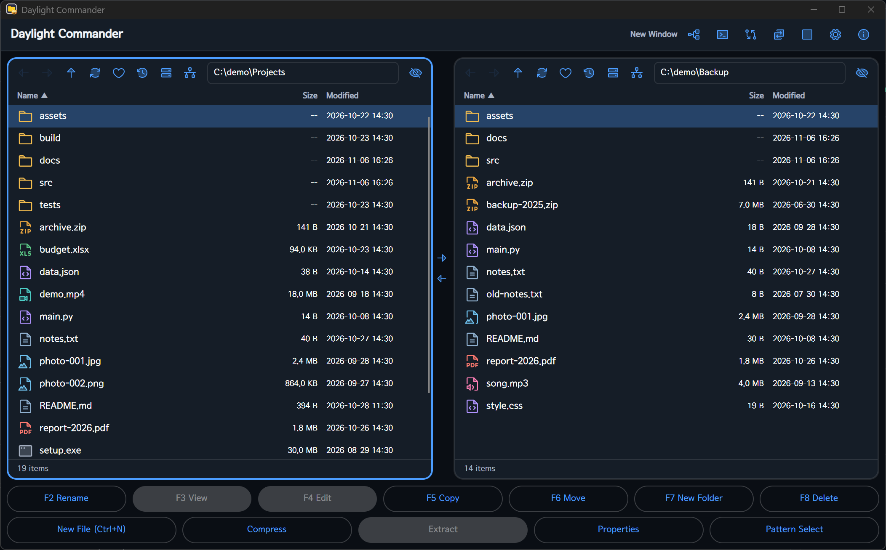
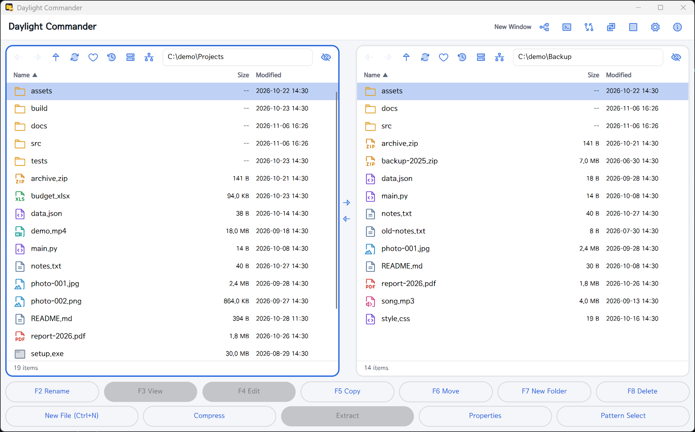
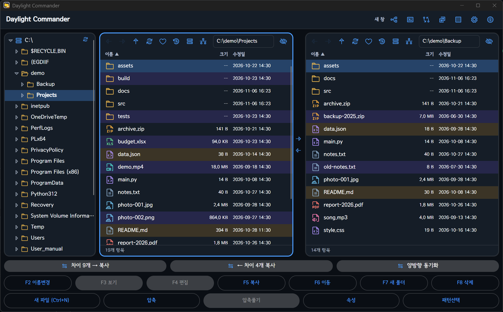
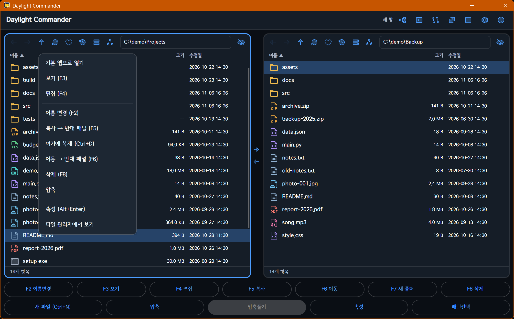
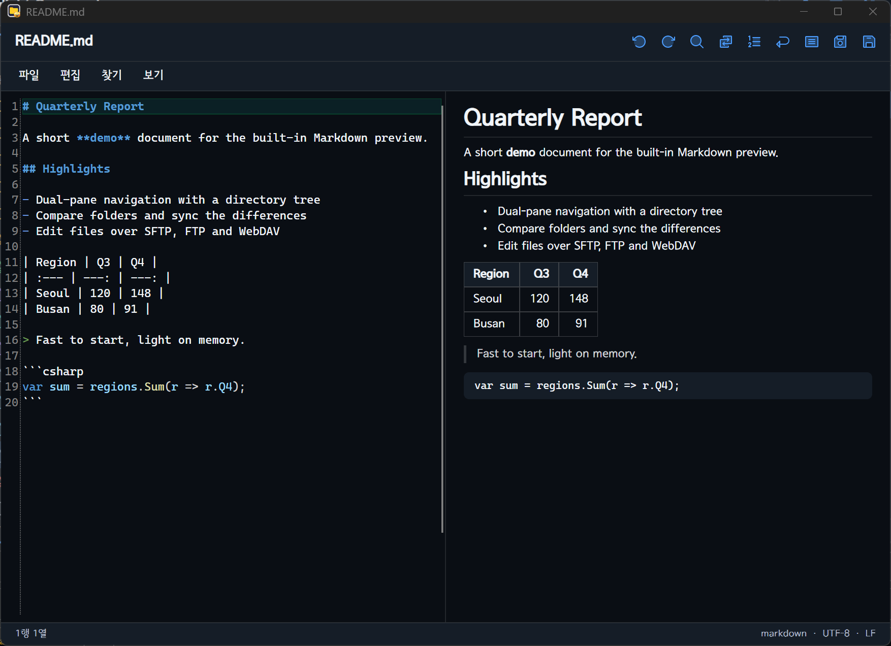
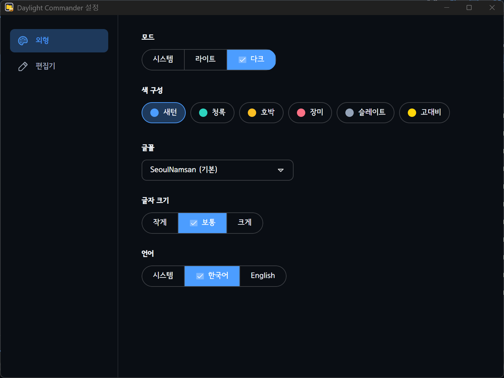

# Daylight Commander (Avalonia)

[](https://github.com/jejezz/daylight-commander-avalonia/releases)
[](#download--install)
[](https://avaloniaui.net)
[](https://learn.microsoft.com/dotnet/core/deploying/native-aot/)
[](LICENSE)

**English | [한국어](README.md)**

A free **dual-pane desktop file manager** in the spirit of Total Commander and Midnight Commander.
Built with C# and [Avalonia](https://avaloniaui.net), published with **.NET 10 NativeAOT** — a single native
executable with no .NET runtime to install, starting in **under a second**. Runs on Windows, macOS and Linux.

> A rewrite of the Flutter original that keeps its look and behavior. Same features, about 30% smaller
> executable, and startup went from roughly 3 s to under 1 s (Explorer-like).

## Screenshots

|                         Dark                         |                         Light                          |
| :--------------------------------------------------: | :----------------------------------------------------: |
|  |  |

**Tree dock + folder compare & sync** — browse in the tree, see the differences between two folders as colors, and bring them in line in one go.



|                  Context menu                  |                  Built-in editor with Markdown preview                  |
| :--------------------------------------------: | :---------------------------------------------------------------------: |
|  |  |

*(Some screenshots show the Korean UI; the language can be switched in Settings.)*

## Features

### Navigation & selection
- **Two panes**: back/forward/up, editable address bar, drive switcher, sortable columns (name/size/date), single-pane mode
- **Tree dock**: browse folders, drag & drop to copy/move, context menu
- **Multi-select**: mouse (click/Shift/Ctrl) and keyboard (Space/Insert), select all, pattern (`*.jpg`) select/deselect
- **Quick filter**: just type in a pane to narrow the list to matching names
- **Favorites, recent folders, hidden-file toggle**

### File operations
- Copy/move (F5/F6, with skip/overwrite/rename/apply-to-all on conflicts), delete (F8, Trash or permanent), new folder (F7)/file, rename (F2), duplicate, progress with cancel
- zip compress/extract, browse inside an archive without extracting
- Properties (Alt+Enter)
- Drag & drop with Explorer/Finder; double-click opens with the OS default app

### Folder compare & sync
- Compare the two panes and highlight differences
- **One-way sync**: copy differing items to the other pane
- **Two-way sync**: files on one side only are copied automatically; files that differ are confirmed one by one

### Network drives
- **SFTP · FTP · WebDAV (HTTP/HTTPS)** — type `sftp://user@host/path` in the address bar or connect from the network menu
- Saved server profiles (host/port/user only — **passwords are never stored**)
- **Remote file editing**: edit a temporary copy; saving uploads it to the server (asks first if it changed on the server)

### Viewer (F3) & editor (F4)
- Viewer: text, images, Markdown, PDF, audio/video (PDF and media use the OS web view)
- Editor: separate window, syntax highlighting (TextMate grammars), find/replace/go to line, Markdown preview (`Ctrl`+`Shift`+`V`), Save As

### Also
- **Light / Dark / System** modes, six color palettes (Saturn, Teal, Amber, Rose, Slate, High contrast), font and text size
- **English / Korean** UI
- Built-in terminal window (`Ctrl`+`` ` ``), duotone file-type icons



## Keyboard shortcuts

Use `⌘` instead of `Ctrl` on macOS.

| Key | Action |
| --- | --- |
| `Tab` | Switch pane |
| `↑` `↓` `PgUp` `PgDn` `Home` `End` | Move cursor |
| `Space` / `Insert` | Toggle selection |
| `Enter` | Open |
| `Backspace` | Up one folder (deletes a character while filtering) |
| `Esc` | Clear selection / filter |
| `F2` | Rename |
| `F3` / `F4` | View / Edit |
| `F5` / `F6` | Copy / Move |
| `F7` | New folder |
| `F8` / `Delete` | Delete (`Shift` = permanent) |
| `Alt`+`←` `→` `↑` | Back / Forward / Up |
| `Alt`+`Enter` | Properties |
| `Ctrl`+`A` | Select all |
| `Ctrl`+`H` | Show hidden files |
| `Ctrl`+`R` | Refresh |
| `Ctrl`+`N` / `Ctrl`+`D` | New file / Duplicate |
| `Ctrl`+`T` | Tree dock |
| `Ctrl`+`U` | Swap panes |
| `Ctrl`+`Shift`+`←` `→` | Sync path to the other pane (→: left to right, ←: right to left) |
| `Ctrl`+`\` | Single / dual pane |
| `` Ctrl+` `` | Terminal |
| `Ctrl`+`,` | Settings |
| `Ctrl`+`W` | Close window |

Editor: `Ctrl`+`S` save, `Ctrl`+`Shift`+`S` save as, `Ctrl`+`F` find, `Ctrl`+`H` replace, `Ctrl`+`G` go to line, `Ctrl`+`D` delete line.

## Download & install

Get it from the [Releases page](https://github.com/jejezz/daylight-commander-avalonia/releases).

| OS | File |
| --- | --- |
| Windows 10/11 (x64) | `*-windows-x64-setup.exe` (installer) or `*-windows-x64.zip` (portable) |
| macOS 11+ (Apple Silicon) | `*-macos-arm64.dmg` |
| Linux (x64) | `*-linux-x64.tar.gz` |

- **Windows**: the installer isn't code-signed yet; if SmartScreen warns, choose **More info → Run anyway**.
- **macOS**: not signed or notarized by Apple. **Right-click → Open** once, or run
  `xattr -dr com.apple.quarantine "/Applications/Daylight Commander.app"`. There is no Intel Mac build yet.
- **Linux**: extract and run `./install.sh` (`--remove` to uninstall). Runs on X11 or XWayland; viewing
  PDF, video and audio needs `libwebkit2gtk-4.1`.

## Build from source

Requires the [.NET 10 SDK](https://dotnet.microsoft.com/download).

```bash
dotnet run -c Release --project src/DaylightCommander.App
```

NativeAOT publish (needs the Visual Studio C++ build tools on Windows, `clang` and `zlib1g-dev` on Linux):

```bash
powershell -File scripts/publish-aot.ps1     # Windows → publish/aot
bash scripts/publish-aot.sh linux-x64        # Linux / macOS (osx-arm64)
```

## Tests

```bash
dotnet test DaylightCommander.slnx
```

The SFTP/FTP/WebDAV integration tests start Python servers (`asyncssh`, `pyftpdlib`, `wsgidav`, `cheroot`);
they are skipped when the packages or Python are missing. Point `DC_TEST_PYTHON` at an interpreter to override.

## Project layout

`Presentation(App) → Services → Domain ← Data` — separate projects so the compiler enforces the dependency direction.
See [ROADMAP.md](ROADMAP.md) for plans and decisions and [CLAUDE.md](CLAUDE.md) for working conventions.

## Settings file

`%APPDATA%\DaylightCommander\settings.json` (Windows). Passwords are never stored.

## License

[MIT](LICENSE) © 2026 Jongyun Ahn
