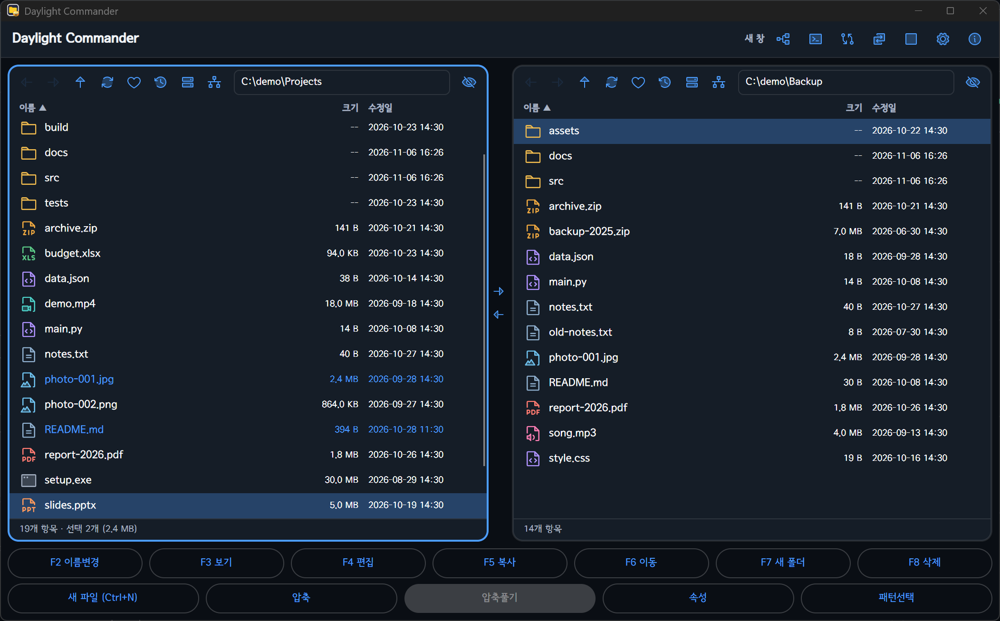
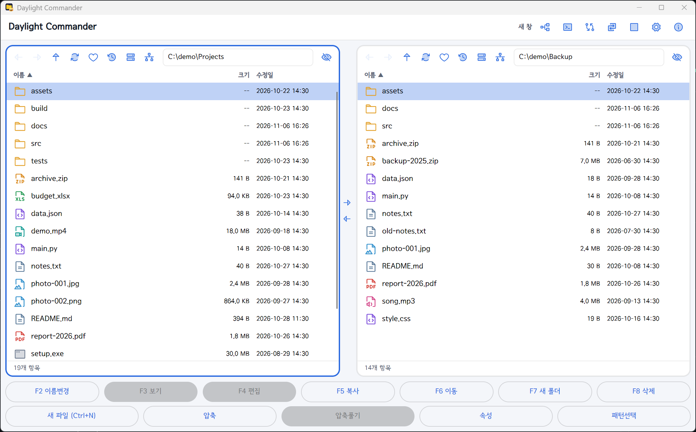
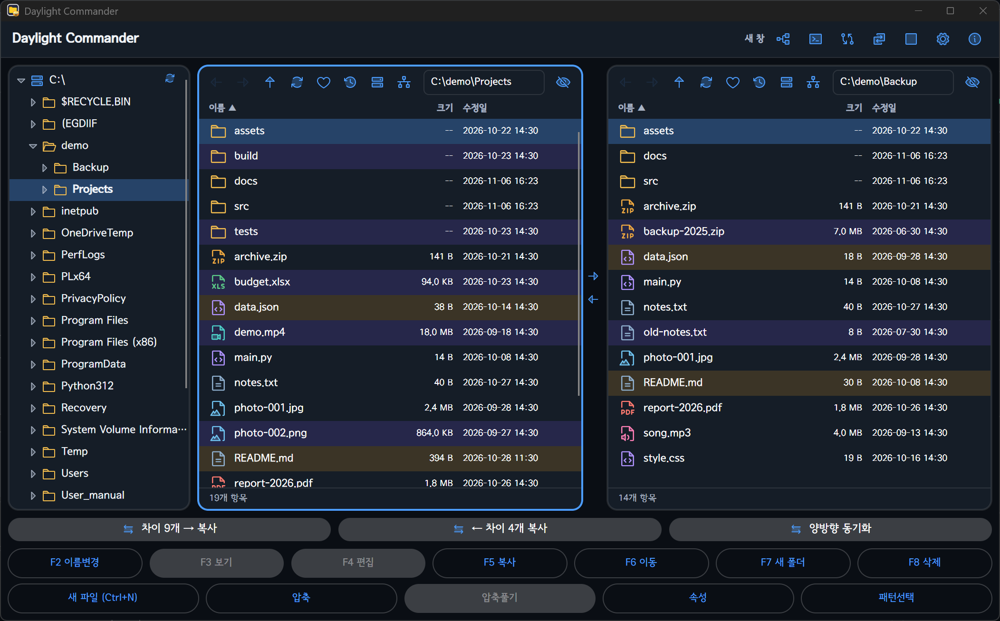
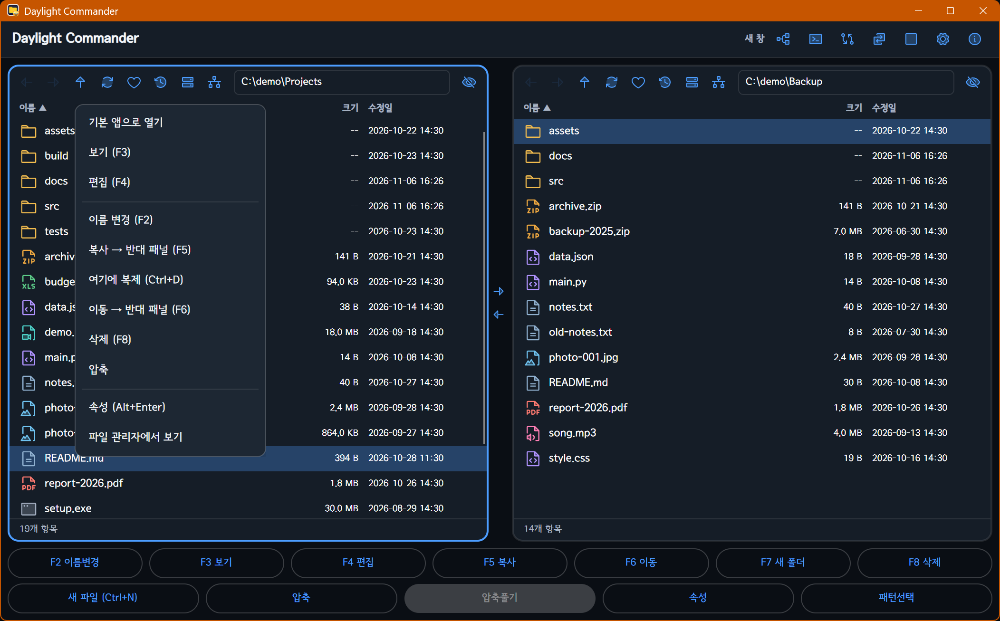
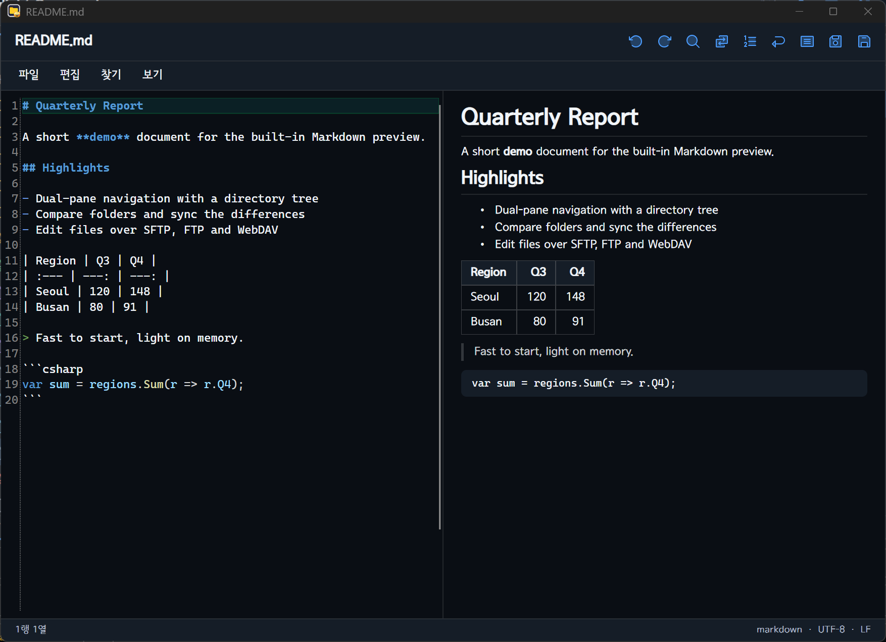
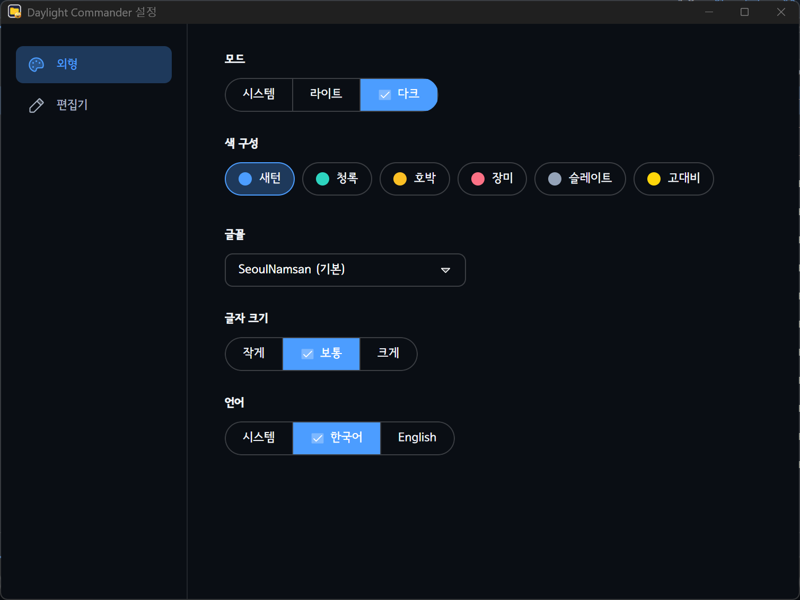

# Daylight Commander (Avalonia)

[](https://github.com/jejezz/daylight-commander-avalonia/releases)
[](#다운로드-및-설치)
[](https://avaloniaui.net)
[](https://learn.microsoft.com/dotnet/core/deploying/native-aot/)
[](LICENSE)

**[English](README.en.md) | 한국어**

Total Commander / Midnight Commander 스타일의 **무료 2단(dual-pane) 데스크톱 파일 매니저**입니다.
C#과 [Avalonia](https://avaloniaui.net)로 만들었고 **.NET 10 NativeAOT**로 게시해,
.NET 런타임 없이 단일 네이티브 실행 파일로 **1초 안에** 뜹니다. Windows · macOS · Linux를 지원합니다.

> Flutter로 만든 원본과 같은 모양·동작을 유지하면서 다시 만든 판입니다.
> 같은 기능에서 실행 파일은 약 30% 작고, 시작은 약 3초 → 1초 이내(탐색기 수준)입니다.

## 스크린샷

|                      다크 테마                       |                      라이트 테마                       |
| :----------------------------------------------: | :-----------------------------------------------: |
|  |  |

**트리 도크 + 폴더 비교·동기화** — 왼쪽 트리에서 폴더를 끌어 놓고, 좌우 폴더의 차이를 색으로 보고 한 번에 맞춥니다.



|                   우클릭 메뉴                    |                    내장 에디터 + Markdown 미리보기                    |
| :------------------------------------------: | :-------------------------------------------------------------: |
|  |  |

## 주요 기능

### 탐색 · 선택
- **2단 패널**: 뒤로/앞으로/상위 폴더, 주소창 직접 입력, 드라이브 전환, 컬럼(이름/크기/수정일) 정렬, 단일 패널 전환
- **트리 도크**: 폴더 트리에서 탐색, 드래그앤드롭으로 복사/이동, 우클릭 메뉴
- **다중 선택**: 마우스(클릭/Shift/Ctrl)와 키보드(Space/Insert), 전체 선택, 패턴(`*.jpg`) 선택/해제
- **퀵 필터**: 패널에서 타이핑하면 이름에 포함된 항목만 즉시 걸러 보임
- **즐겨찾기 · 최근 폴더 · 숨김 파일 토글**

### 파일 작업
- 복사/이동(F5/F6, 충돌 시 건너뛰기/덮어쓰기/이름 바꾸기/모두 적용), 삭제(F8, 휴지통 또는 영구), 새 폴더(F7)/새 파일, 이름 바꾸기(F2), 복제, 진행률 표시와 취소
- zip 압축/풀기, 압축을 풀지 않고 내부 보기
- 속성 보기(Alt+Enter)
- 탐색기/Finder ↔ 앱 드래그앤드롭, 더블클릭은 OS 기본 앱으로 열기

### 폴더 비교 · 동기화
- 좌우 패널을 비교해 차이를 색으로 표시
- **단방향 동기화**: 다른 항목을 반대 패널로 일괄 복사
- **양방향 동기화**: 한쪽에만 있는 파일은 자동 복사, 내용이 다른 파일은 하나씩 확인

### 네트워크 드라이브
- **SFTP · FTP · WebDAV(HTTP/HTTPS)** — 주소창에 `sftp://사용자@호스트/경로`처럼 입력하거나 네트워크 메뉴에서 연결
- 서버 프로필 저장(호스트/포트/계정만, **비밀번호는 저장하지 않음**)
- **원격 파일 편집**: 임시 사본으로 편집하고 저장하면 서버에 올림 (서버에서 먼저 바뀌었으면 확인)

### 내장 뷰어 (F3) · 에디터 (F4)
- 뷰어: 텍스트, 이미지, Markdown, PDF, 오디오/비디오 (PDF·미디어는 OS 웹뷰 사용)
- 에디터: 별도 창, 구문 강조(TextMate 문법), 찾기/바꾸기/줄 이동, Markdown 미리보기(`Ctrl`+`Shift`+`V`), 다른 이름으로 저장

### 그 외
- **라이트/다크/시스템** 모드, 색 구성 6종(새턴·청록·호박·장미·슬레이트·고대비), 글꼴·글자 크기 선택
- **한국어 / English** 화면 언어
- 내장 터미널 창(`Ctrl`+`` ` ``), 파일 형식별 듀오톤 아이콘



## 단축키

`Ctrl` 대신 macOS에서는 `⌘`을 씁니다.

| 키 | 동작 |
| --- | --- |
| `Tab` | 패널 전환 |
| `↑` `↓` `PgUp` `PgDn` `Home` `End` | 커서 이동 |
| `Space` / `Insert` | 선택 토글 |
| `Enter` | 열기 |
| `Backspace` | 상위 폴더 (필터 입력 중에는 글자 지우기) |
| `Esc` | 선택·필터 해제 |
| `F2` | 이름 바꾸기 |
| `F3` / `F4` | 보기 / 편집 |
| `F5` / `F6` | 복사 / 이동 |
| `F7` | 새 폴더 |
| `F8` / `Delete` | 삭제 (`Shift`를 누르면 영구 삭제) |
| `Alt`+`←` `→` `↑` | 뒤로 / 앞으로 / 상위 폴더 |
| `Alt`+`Enter` | 속성 |
| `Ctrl`+`A` | 전체 선택 |
| `Ctrl`+`H` | 숨김 파일 표시 |
| `Ctrl`+`R` | 새로고침 |
| `Ctrl`+`N` / `Ctrl`+`D` | 새 파일 / 복제 |
| `Ctrl`+`T` | 트리 도크 |
| `Ctrl`+`U` | 패널 위치 바꾸기 |
| `Ctrl`+`Shift`+`←` `→` | 한쪽 패널 경로를 반대 패널에 맞추기 (→: 왼쪽→오른쪽, ←: 오른쪽→왼쪽) |
| `Ctrl`+`\` | 단일/2단 패널 |
| `` Ctrl+` `` | 터미널 |
| `Ctrl`+`,` | 설정 |
| `Ctrl`+`W` | 창 닫기 |

에디터: `Ctrl`+`S` 저장, `Ctrl`+`Shift`+`S` 다른 이름으로, `Ctrl`+`F` 찾기, `Ctrl`+`H` 바꾸기, `Ctrl`+`G` 줄 이동, `Ctrl`+`D` 줄 삭제.

## 다운로드 및 설치

[Releases 페이지](https://github.com/jejezz/daylight-commander-avalonia/releases)에서 받을 수 있습니다.

| OS | 받을 파일 |
| --- | --- |
| Windows 10/11 (x64) | `*-windows-x64-setup.exe` (설치) 또는 `*-windows-x64.zip` (설치 없이 실행) |
| macOS 11+ (Apple Silicon) | `*-macos-arm64.dmg` |
| Linux (x64) | `*-linux-x64.tar.gz` |

- **Windows**: 코드 서명이 아직 없어 SmartScreen이 경고하면 **추가 정보 → 실행**을 누릅니다.
- **macOS**: Apple 서명·공증이 없는 빌드입니다. 앱을 **우클릭 → 열기**로 한 번 열거나
  `xattr -dr com.apple.quarantine "/Applications/Daylight Commander.app"` 을 실행하세요.
  Intel Mac용 빌드는 아직 없습니다.
- **Linux**: 압축을 풀고 `./install.sh`(제거는 `--remove`). X11 또는 XWayland에서 실행되며,
  PDF·동영상·음악 보기에는 `libwebkit2gtk-4.1`이 필요합니다.

## 소스에서 빌드

[.NET 10 SDK](https://dotnet.microsoft.com/download)가 필요합니다.

```bash
dotnet run -c Release --project src/DaylightCommander.App
```

NativeAOT 게시(Windows는 Visual Studio C++ 빌드 도구, Linux는 `clang`·`zlib1g-dev` 필요):

```bash
powershell -File scripts/publish-aot.ps1     # Windows → publish/aot
bash scripts/publish-aot.sh linux-x64        # Linux / macOS (osx-arm64)
```

## 테스트

```bash
dotnet test DaylightCommander.slnx
```

SFTP/FTP/WebDAV 통합 테스트는 Python 서버(`asyncssh`, `pyftpdlib`, `wsgidav`, `cheroot`)를 띄웁니다.
패키지가 없거나 Python을 못 찾으면 해당 테스트는 건너뜁니다. 인터프리터는 환경변수 `DC_TEST_PYTHON`으로 지정할 수 있습니다.

## 프로젝트 구조

`Presentation(App) → Services → Domain ← Data` — 프로젝트로 나누어 의존 방향을 컴파일러가 지킵니다.
계획·결정·위험은 [ROADMAP.md](ROADMAP.md), 작업 규약은 [CLAUDE.md](CLAUDE.md)에 있습니다.

## 설정 파일

`%APPDATA%\DaylightCommander\settings.json` (Windows). 비밀번호는 저장하지 않습니다.

## 라이선스

[MIT](LICENSE) © 2026 Jongyun Ahn
